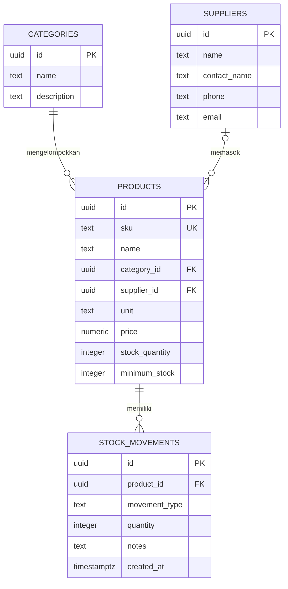

# Sistem Inventory Toko Bangunan Asmara Jaya

Aplikasi inventory HTML/CSS/JavaScript terhubung langsung ke Supabase Auth dan PostgreSQL REST API. Tidak memerlukan Node.js atau server backend.

```text
frontend/  index.html, styles.css, app.js, config.js
backend/   schema.sql
```

## ERD



## Setup Supabase

1. Jalankan `backend/schema.sql` di Supabase SQL Editor. Skrip ini membuat empat tabel, mengaktifkan RLS, dan memberi akses hanya pada pengguna yang login.
2. Di Supabase Authentication, aktifkan provider Email dan buat akun toko melalui **Authentication > Users > Add user**.
3. Buka Supabase **Settings > API Keys**, salin **Publishable key** (`sb_publishable_...`), lalu isi properti `publishableKey` di `frontend/config.js`. URL proyek sudah tersedia di file tersebut.
4. Buka `frontend/index.html` langsung atau sajikan folder `frontend/` dengan static file server. Masuk menggunakan akun yang dibuat di langkah 2.

## Keamanan

Frontend menggunakan publishable key (`sb_publishable_...`) dan access token sesi login. Publishable key boleh berada di frontend, tetapi akses data tetap harus dibatasi dengan RLS. Jangan pernah memasukkan secret key (`sb_secret_...`), key `service_role`, password, atau file `.env` ke GitHub. File environment lokal sudah dikecualikan oleh `.gitignore`. Trigger database memperbarui stok secara atomik dan menolak mutasi stok keluar yang melebihi saldo.

> **Peringatan keamanan**
>
> Riwayat GitHub sebelumnya pernah memuat file `.env` dengan nilai `SUPABASE_SERVICE_ROLE_KEY`. Riwayat branch `main` sudah ditulis ulang agar commit tersebut tidak lagi berada pada riwayat branch.
>
> Tetap segera rotasi atau revoke key tersebut di Supabase. Penulisan ulang riwayat tidak menggantikan rotasi kredensial. File `.env` lokal sudah dikecualikan oleh `.gitignore`.

## GitHub

Repository: [Sistem Inventory Toko Bangunan Asmara Jaya](https://github.com/alifikriasmara02-lang/Sistem-Inventory-Toko-Bangunan-Asmara-Jaya)

Pasang Git for Windows terlebih dahulu jika perintah `git` belum tersedia. Buat repository kosong di GitHub, lalu jalankan dari folder proyek di PowerShell:

```powershell
git init
git add .
git status --short
git check-ignore -v backend/.env
git diff --cached
git commit -m "Sistem inventory Asmara Jaya"
git branch -M main
git remote add origin https://github.com/alifikriasmara02-lang/Sistem-Inventory-Toko-Bangunan-Asmara-Jaya.git
git push -u origin main
```

Sebelum commit, pastikan `backend/.env` tidak muncul pada hasil `git status --short` dan periksa isi staged files dengan `git diff --cached`. Jangan menaruh password atau secret Supabase di URL remote maupun file proyek.