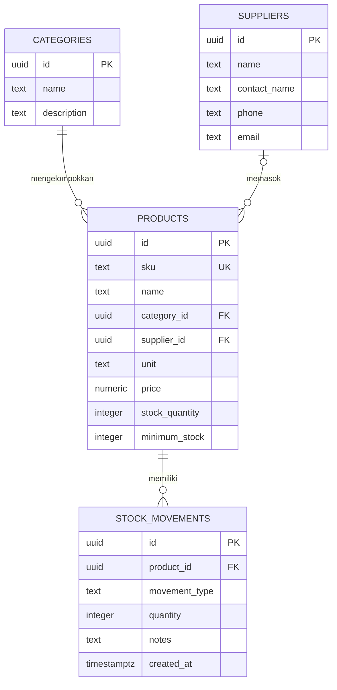

## Demo Aplikasi

**[Buka Sistem Inventory Toko Bangunan Asmara Jaya](https://alifikriasmara02-lang.github.io/Sistem-Inventory-Toko-Bangunan-Asmara-Jaya/)**

username: alifikriasmara02@gmail.com
password: 1234567

# Sistem Inventory Toko Bangunan Asmara Jaya

> - **Nama:** Ali Fikri Asmara
> - **NIM:** 12030124120074
> - **Mata Kuliah:** Pengkodean dan Pemograman
> - **Kelas:** D
> - **Dosen Pengampu:** Dr. Totok Dewayanto, S.E., M.Si., Akt.
>
> Disusun untuk memenuhi Tugas Project UTS Pengkodean dan Pemograman.

## Penjelasan Sistem

Sistem Inventory Toko Bangunan Asmara Jaya adalah aplikasi web untuk memantau katalog barang dan persediaan toko. Pengguna masuk menggunakan akun Supabase, lalu dapat melihat ringkasan stok, mencari dan memfilter barang, menambahkan barang, serta mencatat pergerakan stok masuk dan keluar.

Aplikasi dibuat dengan HTML, CSS, dan JavaScript tanpa proses build atau server aplikasi khusus. Data disimpan di PostgreSQL melalui Supabase REST API, sedangkan Supabase Auth menangani autentikasi pengguna.

## Fitur

- Login dan logout menggunakan akun Supabase.
- Ringkasan jumlah jenis barang, total unit, barang yang mencapai batas stok minimum, dan nilai persediaan.
- Daftar barang dengan pencarian berdasarkan nama atau SKU dan filter kategori.
- Penambahan barang dengan SKU, kategori, pemasok opsional, satuan, harga jual, dan batas stok minimum.
- Pencatatan stok masuk atau keluar dengan jumlah dan catatan opsional.
- Riwayat aktivitas stok terbaru beserta nama barang, waktu, jumlah, dan jenis mutasi.
- Penanda barang tersedia, stok rendah, atau habis, serta tombol muat ulang data.

## Logika Persediaan dan Akuntansi

- Barang baru memiliki jumlah stok awal **0**. Setelah barang ditambahkan, catat mutasi stok masuk untuk menambah persediaan.
- Mutasi masuk menambah stok (`stok baru = stok lama + jumlah`); mutasi keluar menguranginya (`stok baru = stok lama - jumlah`).
- Database menjalankan trigger untuk memperbarui stok saat mutasi dicatat. Mutasi keluar yang melebihi stok yang tersedia ditolak.
- Barang berstatus **stok rendah** jika stoknya lebih besar dari 0 dan sama dengan atau di bawah batas minimum. Status **habis** berlaku saat stok 0.
- Nilai persediaan pada ringkasan dihitung sebagai **jumlah stok × harga jual** setiap barang, lalu dijumlahkan. Angka ini merupakan estimasi berdasarkan harga jual, bukan nilai modal atau penilaian akuntansi persediaan.
- Aplikasi mencatat kuantitas dan riwayat mutasi, tetapi belum mencatat transaksi penjualan/pembelian, harga pokok penjualan, laba, atau jurnal akuntansi. Karena itu, aplikasi ini adalah sistem inventory, bukan sistem pembukuan akuntansi lengkap.

## ERD



**Relasi:** Satu kategori dapat mengelompokkan banyak barang; satu pemasok dapat memasok banyak barang dan pemasok pada barang bersifat opsional. Satu barang dapat memiliki banyak catatan mutasi stok. Barang yang sudah memiliki riwayat mutasi tidak dapat dihapus dari relasinya.

## Struktur Folder

```text
.
├── README.md
├── index.html                      # Pengarah ke aplikasi frontend
├── backend/
│   └── schema.sql                  # Tabel, relasi, RLS, trigger, dan data awal
├── docs/
│   ├── laporan-skema-inventory-asmara-jaya.pdf
│   └── skema-inventory-asmara-jaya.md
└── frontend/
    ├── index.html                  # Antarmuka aplikasi
    ├── app.js                      # Autentikasi, API, dan interaksi aplikasi
    ├── config.js                   # URL Supabase dan publishable key
    └── styles.css                  # Tampilan responsif
```

## Teknologi

- **Frontend:** HTML, CSS, dan JavaScript.
- **Database dan API:** Supabase PostgreSQL dan REST API.
- **Autentikasi:** Supabase Auth dengan provider Email.
- **Keamanan akses data:** PostgreSQL Row Level Security (RLS) untuk pengguna terautentikasi.
- **Hosting demo:** GitHub Pages.
- **Ikon dan font:** Lucide, DM Sans, dan Manrope yang dimuat dari CDN.

## Menjalankan Aplikasi

1. Siapkan proyek Supabase dan jalankan `backend/schema.sql` di **SQL Editor**. Skrip membuat tabel, relasi, trigger stok, kebijakan RLS, kategori, dan pemasok awal.
2. Di Supabase Authentication, aktifkan provider **Email** dan buat akun melalui **Authentication > Users > Add user**.
3. Buka **Settings > API Keys**, salin **Publishable key** (`sb_publishable_...`), lalu isikan properti `publishableKey` di `frontend/config.js`. URL proyek telah dicantumkan di file tersebut.
4. Buka `frontend/index.html` langsung di browser atau sajikan folder `frontend/` menggunakan static file server. Masuk dengan akun yang dibuat pada langkah sebelumnya.

## Catatan Penting dan Keamanan

- Aplikasi demo tetap memerlukan konfigurasi Supabase yang benar dan akun pengguna yang valid. Jangan membagikan kredensial login toko kepada publik.
- Hanya gunakan publishable key (`sb_publishable_...`) di frontend. **Jangan pernah** memasukkan secret key (`sb_secret_...`), key `service_role`, kata sandi, atau file `.env` ke GitHub.
- RLS membatasi akses tabel kepada pengguna yang sudah login. Jangan menonaktifkan RLS untuk membuat aplikasi demo dapat diakses.
- Riwayat GitHub sebelumnya pernah memuat file `.env` dengan nilai `SUPABASE_SERVICE_ROLE_KEY`. Riwayat branch `main` sudah ditulis ulang agar commit tersebut tidak lagi berada pada riwayat branch. **Tetap segera rotasi atau revoke key tersebut di Supabase.** Penulisan ulang riwayat tidak menggantikan rotasi kredensial.
- Tidak memerlukan Node.js atau server backend aplikasi. Koneksi database dan autentikasi dilakukan langsung dari frontend ke Supabase.

## Tautan

- **Demo:** [Sistem Inventory Toko Bangunan Asmara Jaya](https://alifikriasmara02-lang.github.io/Sistem-Inventory-Toko-Bangunan-Asmara-Jaya/)
- **Repository:** [GitHub](https://github.com/alifikriasmara02-lang/Sistem-Inventory-Toko-Bangunan-Asmara-Jaya)
- **Laporan skema:** [docs/laporan-skema-inventory-asmara-jaya.pdf](docs/laporan-skema-inventory-asmara-jaya.pdf)
