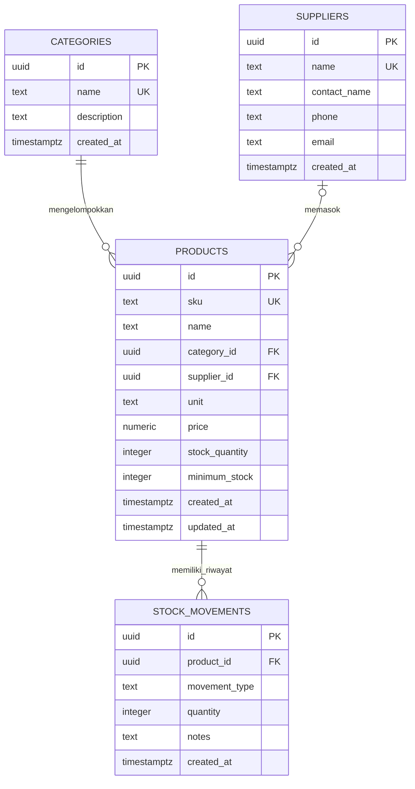

# Dokumentasi Skema Inventory Toko Bangunan Asmara Jaya

## 1. Ringkasan

Dokumen ini menjelaskan skema inventory Supabase PostgreSQL yang digunakan oleh aplikasi Toko Bangunan Asmara Jaya. Database terdiri dari empat entitas:

- `categories`: kelompok barang.
- `suppliers`: data pemasok.
- `products`: katalog barang dan saldo stok saat ini.
- `stock_movements`: riwayat barang masuk dan keluar.

Skema berfokus pada katalog dan persediaan. Transaksi penjualan kasir, pembelian, invoice, retur, dan pencatatan hutang pemasok belum termasuk dalam skema ini.

## 2. ERD

## 3. Penjelasan Relasi ERD

### Kategori ke barang

Relasi `CATEGORIES ||--o{ PRODUCTS` berarti satu kategori dapat mengelompokkan nol atau banyak barang. Setiap barang wajib memiliki tepat satu kategori karena `products.category_id` adalah foreign key `NOT NULL` ke `categories.id`.

Kategori yang sedang dipakai barang tidak dapat dihapus (`ON DELETE RESTRICT`) agar klasifikasi barang tidak kehilangan induknya.

### Pemasok ke barang

Relasi `SUPPLIERS o|--o{ PRODUCTS` berarti satu pemasok dapat terhubung ke nol atau banyak barang, sedangkan sebuah barang boleh tidak memiliki pemasok atau terhubung ke satu pemasok. Kolom `products.supplier_id` bersifat nullable.

Jika pemasok dihapus, hubungan barang ke pemasok menjadi kosong (`ON DELETE SET NULL`); data barang tetap ada.

### Barang ke mutasi stok

Relasi `PRODUCTS ||--o{ STOCK_MOVEMENTS` berarti satu barang dapat memiliki nol atau banyak catatan mutasi. Setiap mutasi wajib menunjuk tepat satu barang melalui `stock_movements.product_id`.

Barang yang memiliki riwayat mutasi tidak dapat dihapus (`ON DELETE RESTRICT`) supaya audit perubahan stok tetap utuh.

## 4. Rincian Entitas

### `categories`

| Kolom | Tipe | Aturan | Keterangan |
| --- | --- | --- | --- |
| `id` | `uuid` | Primary key, default `gen_random_uuid()` | Identitas kategori. |
| `name` | `text` | Wajib, unik | Nama kategori, misalnya Semen & Mortar atau Besi & Baja. |
| `description` | `text` | Opsional | Keterangan kategori. |
| `created_at` | `timestamptz` | Default waktu saat ini | Waktu pembuatan data. |

### `suppliers`

| Kolom | Tipe | Aturan | Keterangan |
| --- | --- | --- | --- |
| `id` | `uuid` | Primary key, default `gen_random_uuid()` | Identitas pemasok. |
| `name` | `text` | Wajib, unik | Nama badan usaha atau pemasok. |
| `contact_name` | `text` | Opsional | Nama orang yang dapat dihubungi. |
| `phone` | `text` | Opsional | Nomor telepon pemasok. |
| `email` | `text` | Opsional | Alamat email pemasok. |
| `created_at` | `timestamptz` | Default waktu saat ini | Waktu pembuatan data. |

### `products`

| Kolom | Tipe | Aturan | Keterangan |
| --- | --- | --- | --- |
| `id` | `uuid` | Primary key, default `gen_random_uuid()` | Identitas barang. |
| `sku` | `text` | Wajib, unik | Kode barang internal. |
| `name` | `text` | Wajib | Nama barang. |
| `category_id` | `uuid` | Wajib, foreign key | Kategori barang. |
| `supplier_id` | `uuid` | Opsional, foreign key | Pemasok utama barang. |
| `unit` | `text` | Default `pcs` | Satuan stok, misalnya sak, batang, atau lembar. |
| `price` | `numeric(14,2)` | Default `0`, tidak boleh negatif | Harga jual terkini per satuan. |
| `stock_quantity` | `integer` | Default `0`, tidak boleh negatif | Saldo stok terkini. |
| `minimum_stock` | `integer` | Default `5`, tidak boleh negatif | Ambang stok rendah untuk kebutuhan restok. |
| `created_at` | `timestamptz` | Default waktu saat ini | Waktu pembuatan barang. |
| `updated_at` | `timestamptz` | Default waktu saat ini | Diperbarui saat trigger memproses mutasi stok. |

`price` merepresentasikan harga terkini, bukan histori perubahan harga. Saldo barang baru dimulai dari nol; catatan `stock_movements` digunakan untuk menaikkan stok awal.

### `stock_movements`

| Kolom | Tipe | Aturan | Keterangan |
| --- | --- | --- | --- |
| `id` | `uuid` | Primary key, default `gen_random_uuid()` | Identitas mutasi. |
| `product_id` | `uuid` | Wajib, foreign key | Barang yang mengalami perubahan stok. |
| `movement_type` | `text` | Hanya `in` atau `out` | Jenis mutasi: barang masuk atau keluar. |
| `quantity` | `integer` | Wajib, harus lebih besar dari nol | Jumlah barang yang dimutasi. |
| `notes` | `text` | Opsional | Catatan alasan atau referensi mutasi. |
| `created_at` | `timestamptz` | Default waktu saat ini | Waktu mutasi dicatat. |

## 5. Aturan Perubahan Stok

Trigger `stock_movement_updates_product` berjalan setiap kali baris baru dimasukkan ke `stock_movements`:

- Mutasi `in` menambah `products.stock_quantity` sebesar `quantity`.
- Mutasi `out` mengurangi saldo sebesar `quantity`.
- Database menolak mutasi keluar yang membuat saldo menjadi negatif.
- Jika produk tidak ada, mutasi ditolak.
- `products.updated_at` diperbarui ketika saldo berubah.

Perubahan mutasi bersifat append-only pada skema ini: grant dan policy memberi izin `SELECT` serta `INSERT`, tetapi tidak memberi izin `UPDATE` atau `DELETE`. Koreksi sebaiknya dicatat sebagai mutasi lawan dengan catatan yang menjelaskan koreksi, bukan mengubah histori lama.

## 6. Indeks dan Performa

Skema membuat indeks pada:

- `products.category_id` untuk pencarian barang per kategori.
- `products.supplier_id` untuk pencarian barang per pemasok.
- `stock_movements(product_id, created_at DESC)` untuk mengambil histori terbaru suatu barang.

Kolom `categories.name`, `suppliers.name`, dan `products.sku` memiliki constraint unik yang juga menyediakan indeks unik.

## 7. Supabase Auth dan RLS

Row Level Security (RLS) aktif pada keempat tabel. Grant dan policy pada skema mengizinkan role `authenticated` untuk:

- Membaca kategori, pemasok, barang, dan mutasi stok.
- Menambahkan kategori, pemasok, barang, dan mutasi stok.
- Tidak mengakses tabel sebagai pengguna anonim melalui policy yang disediakan.

Policy insert kategori dan pemasok menolak nama kosong. Aplikasi frontend memakai publishable key dan sesi Supabase Auth; publishable key bukan pengganti login dan RLS tetap menentukan akses.

## 8. Alur Data Frontend

1. Pengguna masuk melalui Supabase Auth.
2. Dashboard mengambil barang beserta nama kategori/pemasok, daftar kategori, pemasok, dan mutasi stok.
3. Form tambah barang menyimpan `category_id` dan `supplier_id` sebagai foreign key. Pemasok boleh dikosongkan.
4. Form mutasi menyimpan barang, jenis, jumlah, dan catatan ke `stock_movements`.
5. Trigger database memperbarui saldo pada `products`; dashboard memuat ulang ringkasan dan histori.

Walaupun database mengizinkan insert kategori dan pemasok untuk pengguna terautentikasi, frontend saat ini belum menyediakan form pengelolaan kategori/pemasok. Data awal kategori dan pemasok dibuat oleh seed SQL; penambahan berikutnya dapat dilakukan melalui Supabase Table Editor atau fitur UI yang akan ditambahkan terpisah.

## 9. Data Awal

Skrip SQL memasukkan kategori awal berikut bila belum tersedia:

- Semen & Mortar
- Besi & Baja
- Cat & Pelapis
- Pipa & Sanitasi
- Perkakas
- Kayu & Papan

Skrip juga memasukkan tiga pemasok contoh. Klausa `ON CONFLICT DO NOTHING` membuat seed aman dijalankan ulang berdasarkan nama unik.

## 10. Batasan Skema Saat Ini

Skema ini belum mencatat transaksi penjualan, pembelian pemasok, retur barang, perubahan harga historis, pembayaran, atau saldo hutang. Jika dibutuhkan, entitas dan alur tersebut perlu dirancang sebagai pengembangan terpisah; jangan menyimpan transaksi penjualan sebagai mutasi stok saja karena informasi kas dan nilai transaksi tidak tersedia di `stock_movements`.
